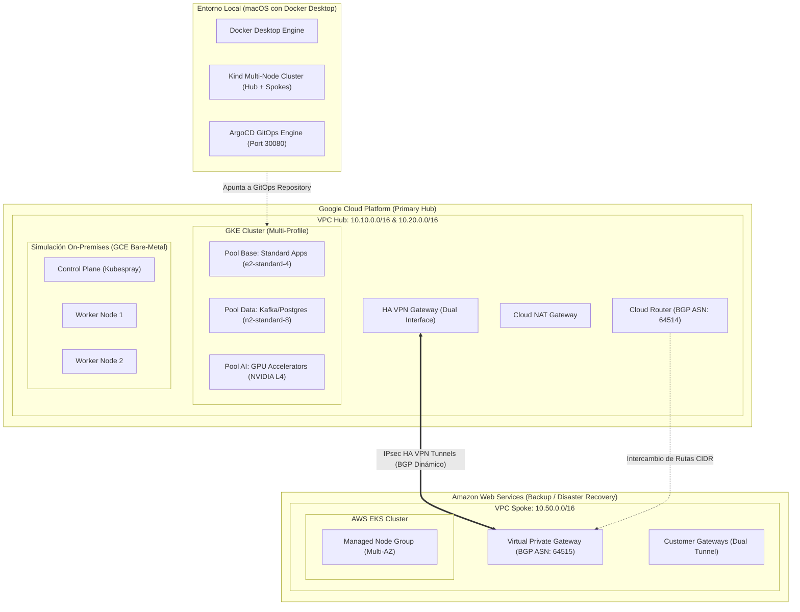

# idp-infra-core 🌐

> **Platform Engineering Core Infrastructure**: Repositorio base de Infraestructura como Código (IaC) para la Plataforma Interna de Desarrollo (IDP). Gestiona la topología de red híbrida y multicloud, clústeres de Kubernetes (GKE, EKS, Kubespray bare-metal y Kind local), interconexiones seguras y aprovisionamiento base.

---

## 📐 Diagrama de Red Híbrida y Multi-Cloud

La infraestructura implementa una arquitectura **Hub & Spoke** con conectividad redundante de alta disponibilidad entre Google Cloud Platform (GCP), Amazon Web Services (AWS), entornos locales y datacenters simulados on-premises.



---

## 🗺️ Plan de Asignación de Red (IPAM)

Para evitar solapamientos entre nubes y ambientes de cómputo, se definieron los siguientes rangos CIDR no solapados:

| Segmento / Entorno | Rango CIDR Principal | Rango Secundario Pods | Rango Secundario Servicios | Notas |
| :--- | :--- | :--- | :--- | :--- |
| **Local Kind** | `172.18.0.0/16` | `10.244.0.0/16` | `10.96.0.0/12` | Simulación en macOS |
| **GCP Dev GKE** | `10.10.0.0/20` | `10.11.0.0/16` | `10.12.0.0/20` | Entorno 01-dev-gcp-hybrid |
| **GCP On-Prem Sim** | `10.10.32.0/24` | `10.233.64.0/18` | `10.233.0.0/18` | VMs GCE + Kubespray |
| **GCP Prod GKE (Regional)** | `10.20.0.0/20` | `10.21.0.0/16` | `10.22.0.0/20` | Entorno 02-prod-multicloud-ha |
| **AWS Prod EKS (Spoke/DR)** | `10.50.0.0/16` | Subredes Privadas | Subredes Públicas | Interconectado vía HA VPN |

---

## 📂 Estructura del Proyecto (Orquestado con Terragrunt)

```text
idp-infra-core/
├── README.md                          # Diagrama de red híbrida y guía de comandos (Make)
├── Makefile                           # Comandos estándar: make up-local, make up-dev-gcp, make up-prod-hybrid
│
├── modules/                           # Bloques de construcción DRY (Terraform puro, 100% reutilizables)
│   ├── gcp-vpc/                       # VPCs Hub & Spokes, subredes, Cloud NAT, Firewall
│   ├── gcp-gke-cluster/               # Módulo genérico multi-perfil (Base, Data, AI con GPUs)
│   ├── gcp-gce-onprem-nodes/          # VMs en GCE + inventario dinámico para simular On-Prem
│   ├── aws-vpc-eks/                   # VPC + EKS en AWS para respaldo/HA multi-cloud
│   └── hybrid-interconnect/           # HA VPN + Cloud Router (GCP <-> AWS) y VPC Peering
│
├── environments/                      # Orquestación declarativa con Terragrunt
│   ├── root.hcl                       # Define remote_state (GCS) y providers de forma centralizada
│   │
│   ├── 01-dev-gcp-hybrid/
│   │   ├── env.hcl                    # Variables globales del entorno (project_id, region, env="dev")
│   │   ├── vpc/
│   │   │   └── terragrunt.hcl         # Llama a modules/gcp-vpc
│   │   ├── gke-cluster/
│   │   │   └── terragrunt.hcl         # Llama a modules/gcp-gke-cluster (depende de ../vpc)
│   │   └── onprem-gce/
│   │       └── terragrunt.hcl         # Llama a modules/gcp-gce-onprem-nodes (depende de ../vpc)
│   │
│   └── 02-prod-multicloud-ha/
│       ├── env.hcl                    # Variables globales de prod (GCP + AWS regions)
│       ├── gcp-vpc/
│       │   └── terragrunt.hcl         # Llama a modules/gcp-vpc
│       ├── aws-vpc-eks/
│       │   └── terragrunt.hcl         # Llama a modules/aws-vpc-eks
│       ├── gke-regional/
│       │   └── terragrunt.hcl         # Llama a modules/gcp-gke-cluster (depende de ../gcp-vpc)
│       └── hybrid-vpn/
│           └── terragrunt.hcl         # Lee outputs de gcp-vpc y aws-vpc-eks automáticamente
│
├── ansible/                           # Configuración de OS y Kubespray (para On-Prem / GCE)
│   ├── inventories/
│   │   ├── gce-onprem-sim/            # Inventario dinámico generado por Terraform/Terragrunt
│   │   └── local-vms/                 # Para uso con Multipass/Lima en Mac
│   ├── playbooks/
│   │   ├── bootstrap-nodes.yml        # Hardening, Docker/containerd, utilidades base
│   │   └── deploy-kubespray.yml       # Wrapper sobre Kubespray para levantar K8s
│   └── group_vars/                    # Variables comunes del clúster bare-metal
│       ├── all.yml
│       └── k8s_cluster.yml
│
└── local-mac/                         # Entorno 1: Desarrollo en Mac con Docker Desktop
    ├── kind-config.yaml               # Clúster multi-nodo local (simula Hub + Spokes)
    └── bootstrap-gitops.sh            # Instala ArgoCD local apuntando a idp-gitops-environments
```

---

## 🛠️ Requisitos Previos

Instala las herramientas requeridas según tu sistema operativo (ejemplo para macOS):

```bash
# Herramientas de contenedores y clúster local
brew install docker kind kubectl helm

# Orquestador y lenguaje IaC
brew install terraform terragrunt ansible

# CLIs de Nube
brew install google-cloud-sdk awscli
```

---

## 🚀 Guía de Comandos Estándar (`Makefile`)

El proyecto cuenta con un `Makefile` interactivo y autocontenido para operar los diferentes entornos.

### Ver ayuda disponible
```bash
make help
```

---

### Entorno 1: Desarrollo Local en Mac (Docker/Colima + Kind + ArgoCD)

Levanta un clúster de 4 nodos en macOS optimizado para Apple Silicon o Intel, configurando el motor GitOps (ArgoCD):

```bash
# Validar runtime Docker, levantar clúster Kind multi-nodo e instalar ArgoCD
make up-local

# Destruir clúster local y detener servicios
make down-local
```

* **Acceso a ArgoCD UI**: [http://localhost:30080](http://localhost:30080)
* **Usuario**: `admin`
* **Contraseña**: Recuperada automáticamente por `bootstrap-gitops.sh`

---

### Entorno 2 y 3: Híbrido en GCP Dev (Terragrunt Orchestration)

1. Ajusta tus variables de proyecto en [environments/01-dev-gcp-hybrid/env.hcl](file:///Users/marcocatalan/Documents/projects_dev/IDP/idp-infra/idp-infra-core/environments/01-dev-gcp-hybrid/env.hcl):
   ```hcl
   project_id = "tu-gcp-project-id"
   region     = "us-central1"
   ```

2. Ejecuta el aprovisionamiento orquestado (Terragrunt resolverá las dependencias en orden: `vpc` ➔ `gke-cluster` y `onprem-gce` en paralelo):
   ```bash
   # Planificar cambios para todos los componentes
   make plan-dev-gcp

   # Aplicar cambios respetando el grafo de dependencias
   make up-dev-gcp
   ```

3. Configura los nodos Bare-Metal simulados con Ansible y Kubespray:
   ```bash
   # Paso 1: Hardening del Sistema Operativo (Swap off, containerd, sysctl)
   make ansible-bootstrap-onprem

   # Paso 2: Despliegue de Kubernetes nativo vía Kubespray
   make ansible-kubespray-onprem
   ```

4. Destrucción del entorno de pruebas:
   ```bash
   make destroy-dev-gcp
   ```

---

### Entorno 4: Producción Multi-Cloud HA (GKE Regional + AWS EKS + HA VPN)

1. Configura tus IDs de cuenta y proyecto en [environments/02-prod-multicloud-ha/env.hcl](file:///Users/marcocatalan/Documents/projects_dev/IDP/idp-infra/idp-infra-core/environments/02-prod-multicloud-ha/env.hcl):
   ```hcl
   gcp_project_id = "tu-gcp-prod-project-id"
   gcp_region     = "us-central1"
   aws_region     = "us-east-1"
   ```

2. Ejecuta el aprovisionamiento multi-cloud:
   ```bash
   # Planificar infraestructura multi-cloud
   make plan-prod-hybrid

   # Levantar VPCs, clústeres y túneles HA VPN (hybrid-vpn lee automáticamente outputs de ambas nubes)
   make up-prod-hybrid
   ```

3. Destrucción del entorno productivo:
   ```bash
   make destroy-prod-hybrid
   ```

---

## 🔒 Buenas Prácticas de Seguridad Implementadas

1. **Least Privilege Service Accounts**: Ningún nodo de GKE o EKS utiliza permisos administrativos por defecto (`Compute Engine default service account` deshabilitada).
2. **Clústeres Privados**: Las direcciones IP de los nodos son privadas; el tráfico saliente a Internet está centralizado mediante Cloud NAT y AWS NAT Gateway.
3. **Acceso Seguro a Nodos Bare-Metal**: Administración remota sin IPs públicas obligatorias, compatible con Cloud Identity-Aware Proxy (IAP).
4. **Tráfico Multi-Cloud Encriptado**: HA VPN con IPsec IKEv2 y enrutamiento dinámico BGP con claves precompartidas rotativas.
